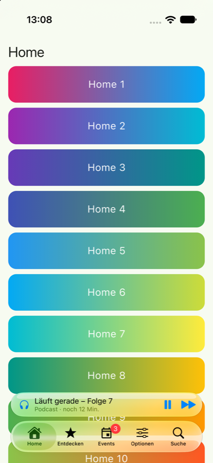
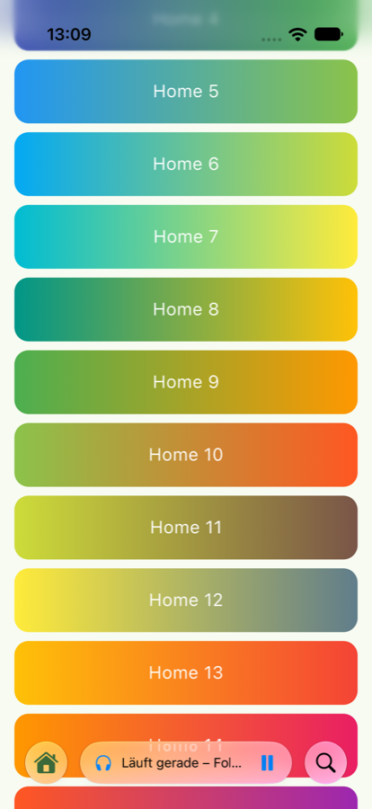
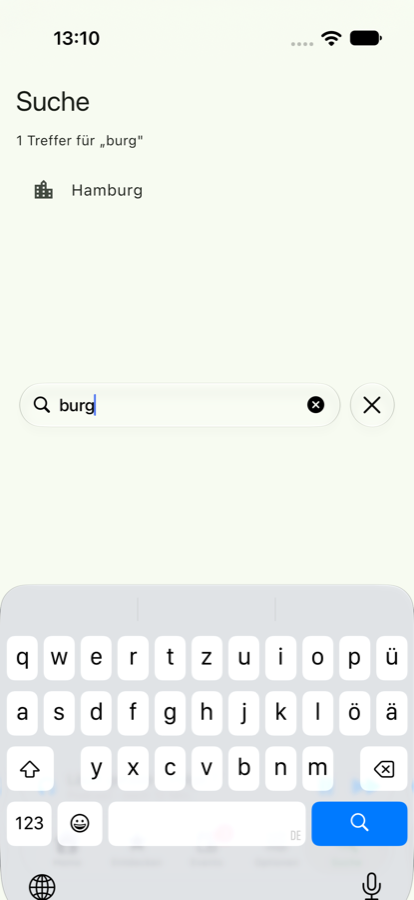
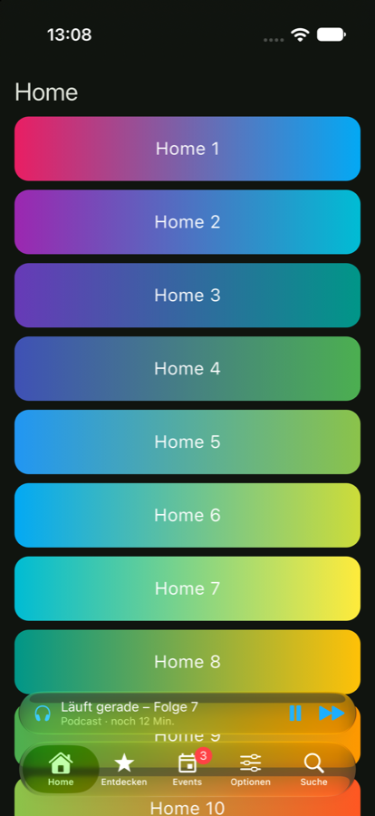
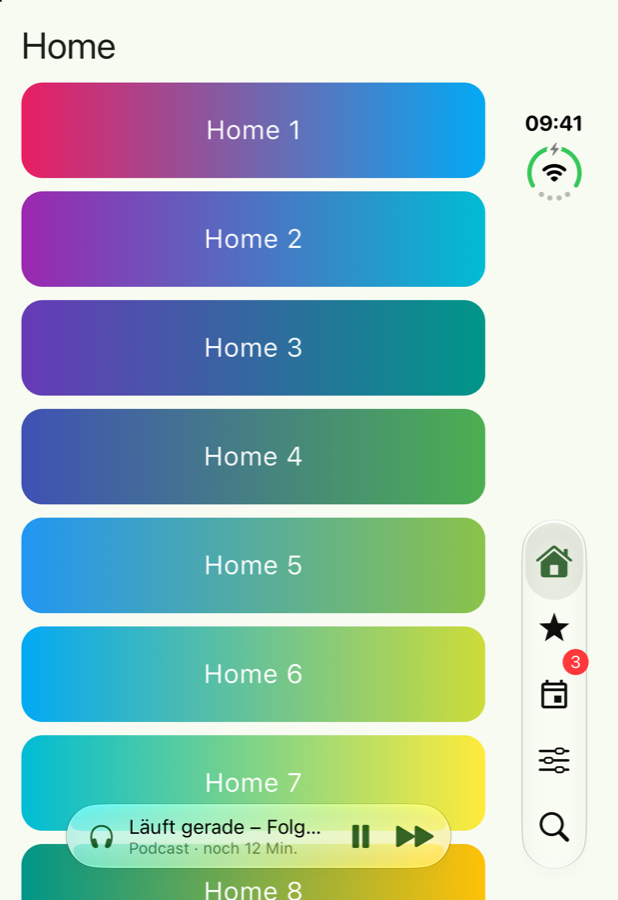

# uikit_tab_bar

The original iOS tab bar for Flutter: a real `UITabBarController` with
Liquid Glass on iOS 26+, made controllable from Dart. It does not imitate
the bar. Everywhere else (iOS < 26, Android, web, desktop) the same
configuration renders a standard `CupertinoTabBar`.

| Glass bar with accessory | Minimized while scrolling | Native search field | Dark | Vertical bar (iPhone Duo) |
| --- | --- | --- | --- | --- |
|  |  |  |  |  |

## Features

| Feature | Native bar | Fallback |
| --- | --- | --- |
| Tabs with SF Symbol, Flutter `IconData` or any `ImageProvider` icon, selected icon | ✓ (selected icon: iOS 26.1+) | ✓ (`fallbackIcon` for SF Symbols) |
| Badges, disabled tabs, hidden tabs | ✓ | ✓ |
| Controlled selection, `onReselect` (scroll to top) | ✓ | ✓ |
| Minimize on scroll (`onScrollDown` / `onScrollUp`) | ✓ | – |
| Bottom accessory with icon, title, subtitle, action buttons | ✓ (regular and inline) | – |
| System search tab with native search field, text to Dart | ✓ | regular tab (bring your own field) |
| Prominent tab | ✓ iOS 27+ | – |
| Hide with the system animation | ✓ | ✓ (without animation) |
| Tint, selected color, title font from app assets, title offset, badge colors, offset and font | ✓ | tint, badge colors, offset and font |
| Light/dark following the app theme (not only the system) | ✓ | ✓ |
| Vertical bar at the leading or trailing edge (iPhone Duo), opt-out | ✓ iOS 27.1+ | – (always at the bottom) |
| Toolbar in the vertical bar: navigation, action groups, badges, priorities, overflow menu | ✓ iOS 27.1+ | – |
| Reported geometry (bottom inset, frames, minimized state) | ✓ | ✓ |

## Usage

```dart
UIKitTabScaffold(
  tabBar: UIKitTabBar(
    tabs: const [
      UIKitTab(
        id: 'home',
        label: 'Home',
        icon: UIKitTabIcon.symbol('house'),
        selectedIcon: UIKitTabIcon.symbol('house.fill'),
        fallbackIcon: Icon(CupertinoIcons.house),
      ),
      UIKitTab(id: 'events', label: 'Events', icon: UIKitTabIcon.icon(Icons.event), badge: '3'),
    ],
    selectedId: selected,
    onSelected: (id) => setState(() => selected = id),
    onReselect: (id) => scrollToTop(id),
    minimizeBehavior: UIKitTabBarMinimizeBehavior.onScrollDown,
    searchTab: UIKitSearchTab(onChanged: (text) => setState(() => query = text)),
    accessory: UIKitTabAccessory(title: 'Now playing', onTap: openPlayer),
    style: UIKitTabBarStyle(tintColor: Theme.of(context).colorScheme.primary),
  ),
  body: IndexedStack(index: indexOf(selected), children: pages),
)
```

* The native bar floats over the content. `UIKitTabScaffold` lets the body
  extend behind it and sets `MediaQuery.padding.bottom` of the body to the
  bar's reported height (83 pt on an iPhone Air, 139 pt with an accessory),
  so `SafeArea` and list paddings keep content clear of the bar.
* Selection is controlled. A tap calls `onSelected`. If you don't change
  `selectedId`, the bar goes back, which is how you veto a tap. A tap on the
  selected tab calls `onReselect` instead.
* For minimizing, the scaffold forwards scroll notifications of the body's
  primary vertical scrollable (`depth == 0`). Tabs kept alive offstage, for
  example in an `IndexedStack`, are ignored. If you place the bar yourself,
  pass a `UIKitTabBarController` and wrap the content in
  `UIKitTabBarScrollListener`.
* Read `UIKitTabBarController.geometry` (or `onGeometryChanged`) for the
  bar's height, frames and minimized state.
* With the vertical bar (below), `UIKitTabScaffold` sets
  `MediaQuery.padding.left` or `right` to the column's width. Keep content
  clear of it the same way as of a landscape safe area, e.g. with
  `SafeArea` or by adding `MediaQuery.paddingOf(context).right` to list
  paddings.
* Put `UIKitTabScaffold` outside any widget that resizes for the keyboard
  (or set `resizeToAvoidBottomInset: false` there), so the bar stays at the
  bottom edge like a native one.
* At most 5 tabs including the search tab. More would open UIKit's "More"
  screen inside the bar.

`example/` shows every option, switchable at runtime.

## Vertical bar (iOS 27.1, iPhone Duo)

On hardware with a vertical bar, UIKit moves the tab bar into a column at
the trailing edge in portrait, and at the left or right edge in landscape
depending on the rotation. The status bar moves into the column too. The
native bar follows this automatically, measured against a pure UIKit
reference app on the iPhone Duo simulator:

| | Bottom bar | Vertical bar |
| --- | --- | --- |
| Tabs | glass bar with titles | glass column, icons only |
| Content insets (`UIKitTabBarGeometry`) | `bottomInset` | `leftInset` / `rightInset` (84 pt incl. the status bar), `bottomInset` for accessory and home indicator |
| Accessory | above the bar | at the bottom of the content |
| Search field | in the bar, at the top while active | at the top |
| Minimize on scroll | ✓ | – (UIKit never minimizes the column) |
| Hide | ✓ | ✓ (the column's width stays reserved, as natively) |
| Tint, selected color, badge colors, offset and font, dark | ✓ | ✓ |

`UIKitTabBarGeometry.verticalBarEdge` tells where the column is
(`none`, `leading`, `trailing`). To keep the bottom bar, set
`verticalBarBehavior: UIKitVerticalBarBehavior.disabled`. Apple recommends
this only for screens that are better served by horizontal bars, as a
stable choice. It applies to the whole window (or presentation), because
UIKit resolves it from the root view controller: the package sets it on
the root of the Flutter view controller's hierarchy.

### Toolbar in the vertical bar

On iPhone Duo the system also moves toolbar and navigation buttons into
the column, above the tabs ([Vertical controls](https://developer.apple.com/design/human-interface-guidelines/designing-for-iphone-duo#Vertical-controls)
in the Human Interface Guidelines). `UIKitTabBar.toolbar` describes them;
UIKit draws, groups and compresses them:

```dart
UIKitTabBar(
  tabs: [...],
  toolbar: UIKitToolbar(
    // Back or Close: at the top of the column.
    navigation: const [
      UIKitToolbarItem(id: 'close', icon: UIKitTabIcon.symbol('xmark'), label: 'Close'),
    ],
    // Actions in groups of related items, prominent ones first.
    groups: const [
      [
        UIKitToolbarItem(
          id: 'compose',
          icon: UIKitTabIcon.symbol('square.and.pencil'),
          label: 'New message',
          style: UIKitToolbarItemStyle.prominent,
          priority: UIKitToolbarItemPriority.high,
        ),
      ],
      [
        UIKitToolbarItem(id: 'inbox', icon: UIKitTabIcon.symbol('tray'), label: 'Inbox', badge: '2'),
        UIKitToolbarItem(id: 'profile', icon: UIKitTabIcon.symbol('person.crop.circle'), label: 'Profile'),
      ],
    ],
    // Extra entries of the system overflow menu.
    menu: const [UIKitToolbarMenuItem(id: 'settings', label: 'Settings')],
    onPressed: (id) { ... },
  ),
)
```

| HIG | API |
| --- | --- |
| Navigation controls at the top, then prominent actions | `navigation`, then `groups` in order; `UIKitToolbarItemStyle.prominent` |
| Group related items, no manual spacing | one list per group in `groups` |
| A title and a symbol for every item | `label` and `icon` are required |
| Badges | `badge` (an empty string shows a dot) |
| Prioritize frequently used items | `priority`: `low`, `standard`, `high` |
| Use the system overflow menu | automatic for items that do not fit; `menu` adds entries |
| Preserve the toolbar or the tab bar when space is limited | `compression`: `prefersTabBar` (default) or `prefersToolbar` |

The buttons take the bar's tint and brightness. Their frames are part of
`UIKitTabBarGeometry.hitRects`; `toolbarRect` is the frame around them.

The toolbar is only shown in the vertical bar. While the bar is horizontal
(other iPhones, the inner display held upright,
`UIKitVerticalBarBehavior.disabled`) and with the fallback bar, nothing is
shown and `toolbarRect` is `null`: show your own bar there, with the same
actions in the same order.

### Toolbar without the tabs

`UIKitTabBar.tabsVisibility` chooses whether the tabs are shown, per screen
and independently of the toolbar. A pushed page that only wants Back at the
top of the column:

```dart
UIKitTabBar(
  tabs: tabs,
  tabsVisibility: detail ? UIKitTabsVisibility.hidden : UIKitTabsVisibility.visible,
  toolbar: UIKitToolbar(
    navigation: [if (detail) back],
    groups: detail ? const [] : actions,
    onPressed: ...,
  ),
)
```

| `tabsVisibility` | Vertical bar | Horizontal bar, fallback bar |
| --- | --- | --- |
| `visible` (default) | tabs and toolbar | tabs |
| `hiddenInVerticalBar` | toolbar only | tabs |
| `hidden` | toolbar only | nothing, like `hidden: true` |

`hidden: true` still hides everything, toolbar included. The tabs stay part
of the bar while they are not shown: selection, badges and order are kept,
and UIKit animates them out and in. Tab visibility and toolbar contents can
change in the same update.

`UIKitTabBarGeometry.tabsHidden` tells that the tabs are not shown;
`hidden` is only `true` when the toolbar is not shown either. Without the
tabs, `hitRects` holds just the toolbar's buttons (`toolbarRect`), so the
rest of the column lets touches through, and `compression` has nothing to
weigh up.

Do not mark every tab `UIKitTab.hidden` to get there. That is now handled
like `UIKitTabsVisibility.hidden` (UIKit does not recover from an empty set
of tabs), but `tabsVisibility` says what is meant. A bar that never had a
visible tab shows no toolbar either.

## What works under Liquid Glass

Measured on iOS 27 (iPhone Air simulator). Only what takes effect is
offered in `UIKitTabBarStyle`.

| UIKit property | Under Liquid Glass | In the API |
| --- | --- | --- |
| `UITabBar.tintColor` | works (selected tab); the vertical bar uses the tab bar controller's view tint instead, which is set too | `tintColor` |
| Item appearance, selected: `iconColor`, title color | works | `selectedColor` |
| Item appearance: title font (size, weight, custom font) | works | `titleFontSize`, `titleFontWeight`, `titleFontAsset` |
| Item appearance: `titlePositionAdjustment` | works | `titleOffset` |
| Item appearance: `badgeBackgroundColor`, `badgeTextAttributes` | works | `badgeColor`, `badgeTextColor` |
| Item appearance: `badgeTextAttributes` font (size, weight) | works; the badge resizes with the text | `badgeFontSize`, `badgeFontWeight` |
| Item appearance: `badgePositionAdjustment` | works for the whole bar; horizontal points toward the leading edge (the API flips it so `dx` points toward the end) | `badgeOffset` |
| The same per tab (`UITabBarItem.standardAppearance`) | no effect | – |
| Item appearance: `badgeTitlePositionAdjustment` | works, but moves the text out of the badge | – |
| `overrideUserInterfaceStyle` | works | `brightness` (default: app theme) |
| `UITab.isEnabled` | works (dimmed) | `UIKitTab.enabled` |
| `unselectedItemTintColor`, item appearance normal `iconColor` / title color | no effect (the system picks legible colors) | – |
| `UITabBarAppearance.backgroundColor`, `barTintColor`, shadow | no effect (glass) | – |
| `selectionIndicatorTintColor` | no visible effect | – |
| `UITab.subtitle` | sidebar only, not shown in the bar | `UIKitTab.subtitle` (passed through) |
| `UITab.isHidden` | sidebar customization only | `UIKitTab.hidden` is implemented by removing the tab |

## How it works

* A `UITabBarController` is a child view controller inside a platform view
  that covers the bottom 200 pt of the screen (the full height while the
  vertical bar is shown or the search field is active). Its tab content controllers
  are transparent placeholders; the content is Flutter, behind them.
* UIKit reports the frames of the glass pills, accessory and search field
  after every layout change and during animations. A render object lets
  only touches inside those frames reach the platform view. Everything
  else goes to Flutter.
* UIKit only minimizes for real pans of the content scroll view. An
  invisible proxy `UIScrollView` stands in for the Flutter scrollable: its
  pan recognizer is moved onto the FlutterView, so the user's finger drives
  it while Flutter scrolls from the same touches. Outside a drag it mirrors
  Flutter's position. Behavior was verified against a pure UIKit reference
  app with the same gestures.
* Dart sends the complete state on every change; Swift diffs it and applies
  the changes in one batch (`performBatchUpdates` on iOS 27+). Hot reload just
  works.
* Non-symbol icons are rendered in Dart at device scale and sent once as
  template images. Fonts from the app's assets are registered natively.

## Limits

* **Minimize gating.** While minimizing is on and the selected tab is
  scrollable, any vertical pan on the Flutter view counts, also on a sheet
  or dialog covering the content. Set `minimizeBehavior` to `never` (or hide
  the bar) while such overlays are open.
* **Expand at the top** after a Flutter fling is triggered explicitly by
  re-applying the minimize behavior, because UIKit ignores the programmatic
  scroll position. A scroll back up during a drag expands natively.
* **Accessory content** is native, described by its fields. Arbitrary
  Flutter widgets inside it would need a second Flutter engine.
* **Search mode.** While the native search field is active, the platform
  view fills the screen so UIKit shows the field at the top, as natively;
  `UIKitTabScaffold` pads the content top by `UIKitTabBarGeometry.topInset`.
* **Vertical bar.** Verified on the iPhone Duo simulator: folded (iOS 27.1
  and 27.2) in portrait and both landscape orientations, unfolded
  (iOS 27.2) in all orientations. Unfolded, UIKit shows the column only
  while the window is wider than tall; rotated, the bar is at the bottom.
  All positions come from UIKit, nothing assumes a screen size.
* **iPad.** The phone-style bottom bar is shown (compact size class). The
  top tab bar, sidebar, tab groups and drag and drop are not supported.
* **Overlays.** Flutter content painted above the bar region (dialogs,
  sheets, snack bars) is composited in separate layers, as with every
  platform view.

## Platform support

* iOS 26+: native bar. iOS 15.6 to 25: `CupertinoTabBar`. The plugin's
  minimum iOS version is 15.6; newer APIs are behind `#available`.
* Swift Package Manager and CocoaPods.
* All other platforms: `CupertinoTabBar` (the plugin has no native part
  there).

### Requirements

The native bar needs Xcode 26 (iOS 26 SDK) or later to build. Features that
use newer APIs are compiled in only with the SDK that declares them; with an
older Xcode the package still builds and the feature is left out:

| Feature | Needs to build | At runtime |
| --- | --- | --- |
| Native bar, minimize, accessory, search tab | Xcode 26 (iOS 26 SDK) | iOS 26+ |
| Selected tab icon (`UIKitTab.selectedIcon`) | Xcode 26.1.1 (iOS 26.1 SDK) | iOS 26.1+ |
| Prominent tab, batched animated updates | Xcode 27 (iOS 27 SDK) | iOS 27+ |
| Vertical bar, `verticalBarBehavior` | any of the above (used dynamically) | iOS 27.1+ |
